<p align="center">
  
</p>

<h1 align="center">chock-devin-plugins</h1>

<p align="center"><strong>Blocks your Devin agent's wrong moves before they land.</strong></p>
<p align="center">Chock policies as Devin plugins — a real hook that can deny a command, best-effort and fail-open by the vendor's own design.</p>

<p align="center">

[](https://github.com/open-coder-ai/chock-devin-plugins/actions/workflows/generated-only.yml)
[](LICENSE)
[](https://github.com/open-coder-ai/chock-catalog)

</p>

<p align="center">
  
</p>

An agent you're running can already touch your shell, your git history, and your CI config.
You want it to move fast without being the reason a stray `helm uninstall` actually happens.
Telling it to be careful in a prompt is not a guarantee; a plugin that can refuse the command
is closer to one. Devin's own documentation is explicit that plugin hooks are **"currently
best effort and fail open — if a hook fails to load or run, the session continues without it
— so don't rely on them for crucial guardrails yet."** No `devin plugins install` run against
these packages has been recorded yet; the claims on this page come from Devin's published
documentation (docs.devin.ai, read 2026-09-21), not from a witnessed install.

**Local sessions only.** Plugin hooks are registered in Devin CLI and Devin Desktop sessions.
They are not registered in Devin's cloud sessions — a guard installed from here has no effect
there. A hook's exit code decides the outcome: `2` blocks the tool call, `0` lets it continue,
and any other exit is logged but does not block. The shipped hook is wired as `PreToolUse` in
each plugin's `hooks.json`; when it denies, it prints a JSON decision on stdout,
`{"decision": "block", "reason": "..."}`, and exits 0, and it exits 2 only when the hook cannot run or
itself faults. Whether Devin honours that JSON decision has not been witnessed, because no
install has been recorded (see above).

## Moved to the chock.sh builder

These plugins now come from the chock.sh builder: **https://chock.sh/coding/builder/**. You pick
the policies, and `chock install` generates one plugin on your machine; nothing is downloaded
from this repository. This repository stops publishing on the chock.sh launch day and is
archived 30 days later.

### Moving off a plugin installed from this repository

1. Remove what you installed from here, so the same guard does not run twice. List it with
   `devin plugins list`, then remove the root meta-plugin and any single policy:

   ```
   devin plugins remove chock-devin
   devin plugins remove <policy-id>
   ```

   This repository is not a marketplace, so there is no marketplace to remove.
2. Install the CLI: `pip install chock`.
3. Open the builder, pick your policies, and run the command it prints:

   ```
   chock install --selection '<code>' --client devin --apply
   ```

### One policy at a time

Each link opens the builder for Devin with that one policy preselected. Every link pins the
chock-catalog commit `e885f918a335e20dfddb4fad0331d4d5b4c5eb43`, so each row names the policy
version at that commit, which can be newer than the version in [PLUGINS.md](PLUGINS.md).

| policy | version | builder |
| :--- | :--- | :--- |
| `agent-discipline` | 0.0.3 | [Open in the builder](https://chock.sh/coding/builder/#s=eyJzY2hlbWEiOjIsImNsaWVudCI6ImRldmluIiwiYnVuZGxlIjp7InZlcnNpb24iOiIxLjAuMCJ9LCJjYXRhbG9nIjp7InNvdXJjZSI6Imh0dHBzOi8vZ2l0aHViLmNvbS9vcGVuLWNvZGVyLWFpL2Nob2NrLWNhdGFsb2ciLCJyZWYiOiJlODg1ZjkxOGEzMzVlMjBkZmRkYjRmYWQwMzMxZDRkNWI0YzVlYjQzIn0sInBvbGljaWVzIjpbeyJmcm9tIjoiY2F0YWxvZyIsImlkIjoiYWdlbnQtZGlzY2lwbGluZSIsInZlcnNpb24iOiIwLjAuMyIsInNoYTI1NiI6IjAzOGIxOWQ3MjZlZmMxMjVlZWFmMTMyMWFjNGZlYjcwYzdmZDFhMjA3ZGE4ZTg5NTNiZWQ2NWQ0YWNkZDg0NzIifV19) |
| `block-curl-pipe-sh` | 0.1.4 | [Open in the builder](https://chock.sh/coding/builder/#s=eyJzY2hlbWEiOjIsImNsaWVudCI6ImRldmluIiwiYnVuZGxlIjp7InZlcnNpb24iOiIxLjAuMCJ9LCJjYXRhbG9nIjp7InNvdXJjZSI6Imh0dHBzOi8vZ2l0aHViLmNvbS9vcGVuLWNvZGVyLWFpL2Nob2NrLWNhdGFsb2ciLCJyZWYiOiJlODg1ZjkxOGEzMzVlMjBkZmRkYjRmYWQwMzMxZDRkNWI0YzVlYjQzIn0sInBvbGljaWVzIjpbeyJmcm9tIjoiY2F0YWxvZyIsImlkIjoiYmxvY2stY3VybC1waXBlLXNoIiwidmVyc2lvbiI6IjAuMS40Iiwic2hhMjU2IjoiMzRiOTYxYzQ4MjU4OGQwYjUxYzhkYzc2NTVlOTE1ZWE5OGM1YzQ3MDI3ZGNhMTE0ZjhhN2QxMjdmMzc2NjJmMiJ9XX0) |
| `block-destructive-commands` | 0.3.0 | [Open in the builder](https://chock.sh/coding/builder/#s=eyJzY2hlbWEiOjIsImNsaWVudCI6ImRldmluIiwiYnVuZGxlIjp7InZlcnNpb24iOiIxLjAuMCJ9LCJjYXRhbG9nIjp7InNvdXJjZSI6Imh0dHBzOi8vZ2l0aHViLmNvbS9vcGVuLWNvZGVyLWFpL2Nob2NrLWNhdGFsb2ciLCJyZWYiOiJlODg1ZjkxOGEzMzVlMjBkZmRkYjRmYWQwMzMxZDRkNWI0YzVlYjQzIn0sInBvbGljaWVzIjpbeyJmcm9tIjoiY2F0YWxvZyIsImlkIjoiYmxvY2stZGVzdHJ1Y3RpdmUtY29tbWFuZHMiLCJ2ZXJzaW9uIjoiMC4zLjAiLCJzaGEyNTYiOiI1NDFiNGQzMjc3ODg0MjQ4ZDMyMTYwMWQwNGNlMDE4MjUzN2MzMGUyNTk2ZGM3ODBjMDAxYWU1MzJiMWI5ZDUwIn1dfQ) |
| `block-invisible-unicode` | 0.1.1 | [Open in the builder](https://chock.sh/coding/builder/#s=eyJzY2hlbWEiOjIsImNsaWVudCI6ImRldmluIiwiYnVuZGxlIjp7InZlcnNpb24iOiIxLjAuMCJ9LCJjYXRhbG9nIjp7InNvdXJjZSI6Imh0dHBzOi8vZ2l0aHViLmNvbS9vcGVuLWNvZGVyLWFpL2Nob2NrLWNhdGFsb2ciLCJyZWYiOiJlODg1ZjkxOGEzMzVlMjBkZmRkYjRmYWQwMzMxZDRkNWI0YzVlYjQzIn0sInBvbGljaWVzIjpbeyJmcm9tIjoiY2F0YWxvZyIsImlkIjoiYmxvY2staW52aXNpYmxlLXVuaWNvZGUiLCJ2ZXJzaW9uIjoiMC4xLjEiLCJzaGEyNTYiOiJiMTA4NDMxNTcwNmRjMjZlMzA5N2RkMWMxYTg5M2M3ODA0MTVmMTE2OGFiNWE5OTVjMTlhODk1ZjkzNjg4YzVhIn1dfQ) |
| `block-no-verify` | 0.5.0 | [Open in the builder](https://chock.sh/coding/builder/#s=eyJzY2hlbWEiOjIsImNsaWVudCI6ImRldmluIiwiYnVuZGxlIjp7InZlcnNpb24iOiIxLjAuMCJ9LCJjYXRhbG9nIjp7InNvdXJjZSI6Imh0dHBzOi8vZ2l0aHViLmNvbS9vcGVuLWNvZGVyLWFpL2Nob2NrLWNhdGFsb2ciLCJyZWYiOiJlODg1ZjkxOGEzMzVlMjBkZmRkYjRmYWQwMzMxZDRkNWI0YzVlYjQzIn0sInBvbGljaWVzIjpbeyJmcm9tIjoiY2F0YWxvZyIsImlkIjoiYmxvY2stbm8tdmVyaWZ5IiwidmVyc2lvbiI6IjAuNS4wIiwic2hhMjU2IjoiYTQwNmQ1MGU0Y2YzMGQ1NjQzMDg0MDgwYWQ0MjU5ZDM0MmYzZWRkMDcwMzY4ODhjNDdhODIxNGY2NjA5OTRjYyJ9XX0) |
| `block-test-skips` | 0.1.0 | [Open in the builder](https://chock.sh/coding/builder/#s=eyJzY2hlbWEiOjIsImNsaWVudCI6ImRldmluIiwiYnVuZGxlIjp7InZlcnNpb24iOiIxLjAuMCJ9LCJjYXRhbG9nIjp7InNvdXJjZSI6Imh0dHBzOi8vZ2l0aHViLmNvbS9vcGVuLWNvZGVyLWFpL2Nob2NrLWNhdGFsb2ciLCJyZWYiOiJlODg1ZjkxOGEzMzVlMjBkZmRkYjRmYWQwMzMxZDRkNWI0YzVlYjQzIn0sInBvbGljaWVzIjpbeyJmcm9tIjoiY2F0YWxvZyIsImlkIjoiYmxvY2stdGVzdC1za2lwcyIsInZlcnNpb24iOiIwLjEuMCIsInNoYTI1NiI6Ijg1MzVjNTJlZDA1NWIwODRiM2Q4NzBiMzM5NDQ4NzQxZTE4MzRmNmZkOTFhYjJkMzJlYWQxZDI2M2Y0NzU1NzQifV19) |
| `block-unapproved-egress` | 0.2.4 | [Open in the builder](https://chock.sh/coding/builder/#s=eyJzY2hlbWEiOjIsImNsaWVudCI6ImRldmluIiwiYnVuZGxlIjp7InZlcnNpb24iOiIxLjAuMCJ9LCJjYXRhbG9nIjp7InNvdXJjZSI6Imh0dHBzOi8vZ2l0aHViLmNvbS9vcGVuLWNvZGVyLWFpL2Nob2NrLWNhdGFsb2ciLCJyZWYiOiJlODg1ZjkxOGEzMzVlMjBkZmRkYjRmYWQwMzMxZDRkNWI0YzVlYjQzIn0sInBvbGljaWVzIjpbeyJmcm9tIjoiY2F0YWxvZyIsImlkIjoiYmxvY2stdW5hcHByb3ZlZC1lZ3Jlc3MiLCJ2ZXJzaW9uIjoiMC4yLjQiLCJzaGEyNTYiOiJlNDg2ZmUzN2IxMjFjMjA1NDFmNzFjZWY2Y2I4NTYwNWZlMGEwNmVlZWI2ZTU2MzgzYzk4ZmZiMDBjMDA3ZTEwIn1dfQ) |
| `block-unguarded-agent-spawn` | 0.2.0 | [Open in the builder](https://chock.sh/coding/builder/#s=eyJzY2hlbWEiOjIsImNsaWVudCI6ImRldmluIiwiYnVuZGxlIjp7InZlcnNpb24iOiIxLjAuMCJ9LCJjYXRhbG9nIjp7InNvdXJjZSI6Imh0dHBzOi8vZ2l0aHViLmNvbS9vcGVuLWNvZGVyLWFpL2Nob2NrLWNhdGFsb2ciLCJyZWYiOiJlODg1ZjkxOGEzMzVlMjBkZmRkYjRmYWQwMzMxZDRkNWI0YzVlYjQzIn0sInBvbGljaWVzIjpbeyJmcm9tIjoiY2F0YWxvZyIsImlkIjoiYmxvY2stdW5ndWFyZGVkLWFnZW50LXNwYXduIiwidmVyc2lvbiI6IjAuMi4wIiwic2hhMjU2IjoiZTQ1YzIxNTUxZjFmMWEyNDIyNzU2ODNhZmU5YWUwMDQ2Mjc3ZDhkNTdmNTM3MzQ0YWM3MTNmZmJmYmE0NjEzNyJ9XX0) |
| `block-wildcard-agent-permissions` | 0.0.10 | [Open in the builder](https://chock.sh/coding/builder/#s=eyJzY2hlbWEiOjIsImNsaWVudCI6ImRldmluIiwiYnVuZGxlIjp7InZlcnNpb24iOiIxLjAuMCJ9LCJjYXRhbG9nIjp7InNvdXJjZSI6Imh0dHBzOi8vZ2l0aHViLmNvbS9vcGVuLWNvZGVyLWFpL2Nob2NrLWNhdGFsb2ciLCJyZWYiOiJlODg1ZjkxOGEzMzVlMjBkZmRkYjRmYWQwMzMxZDRkNWI0YzVlYjQzIn0sInBvbGljaWVzIjpbeyJmcm9tIjoiY2F0YWxvZyIsImlkIjoiYmxvY2std2lsZGNhcmQtYWdlbnQtcGVybWlzc2lvbnMiLCJ2ZXJzaW9uIjoiMC4wLjEwIiwic2hhMjU2IjoiNmIzMTlkZjY4ZjAzYzkzNjI2YzY5NWQyOTg3MGMxNzk0NTZlZmJkZjRlZmIzMzAxMmJlOWZkMGVkOGEzOGVlZCJ9XX0) |
| `chock-mise` | 0.0.3 | [Open in the builder](https://chock.sh/coding/builder/#s=eyJzY2hlbWEiOjIsImNsaWVudCI6ImRldmluIiwiYnVuZGxlIjp7InZlcnNpb24iOiIxLjAuMCJ9LCJjYXRhbG9nIjp7InNvdXJjZSI6Imh0dHBzOi8vZ2l0aHViLmNvbS9vcGVuLWNvZGVyLWFpL2Nob2NrLWNhdGFsb2ciLCJyZWYiOiJlODg1ZjkxOGEzMzVlMjBkZmRkYjRmYWQwMzMxZDRkNWI0YzVlYjQzIn0sInBvbGljaWVzIjpbeyJmcm9tIjoiY2F0YWxvZyIsImlkIjoiY2hvY2stbWlzZSIsInZlcnNpb24iOiIwLjAuMyIsInNoYTI1NiI6IjFiMDcyYmQ1MTc0YWM4YTc1YmQ0NDRlZDEwMGQ0MWNkYjc2Y2MzOWYxZDY2Yzg2NmE3YzJkOWE3M2VlY2Y1MWYifV19) |
| `code-safety` | 0.0.4 | [Open in the builder](https://chock.sh/coding/builder/#s=eyJzY2hlbWEiOjIsImNsaWVudCI6ImRldmluIiwiYnVuZGxlIjp7InZlcnNpb24iOiIxLjAuMCJ9LCJjYXRhbG9nIjp7InNvdXJjZSI6Imh0dHBzOi8vZ2l0aHViLmNvbS9vcGVuLWNvZGVyLWFpL2Nob2NrLWNhdGFsb2ciLCJyZWYiOiJlODg1ZjkxOGEzMzVlMjBkZmRkYjRmYWQwMzMxZDRkNWI0YzVlYjQzIn0sInBvbGljaWVzIjpbeyJmcm9tIjoiY2F0YWxvZyIsImlkIjoiY29kZS1zYWZldHkiLCJ2ZXJzaW9uIjoiMC4wLjQiLCJzaGEyNTYiOiI1MTA2Nzk1MTIzNWE5YWRkMzBmMmFmYTIwNzYyYzUzZmQzOTJiYTJkNTczODQ1OTcwYzI5YmQzMDI5NTFlYWUyIn1dfQ) |
| `context-hygiene` | 0.0.2 | [Open in the builder](https://chock.sh/coding/builder/#s=eyJzY2hlbWEiOjIsImNsaWVudCI6ImRldmluIiwiYnVuZGxlIjp7InZlcnNpb24iOiIxLjAuMCJ9LCJjYXRhbG9nIjp7InNvdXJjZSI6Imh0dHBzOi8vZ2l0aHViLmNvbS9vcGVuLWNvZGVyLWFpL2Nob2NrLWNhdGFsb2ciLCJyZWYiOiJlODg1ZjkxOGEzMzVlMjBkZmRkYjRmYWQwMzMxZDRkNWI0YzVlYjQzIn0sInBvbGljaWVzIjpbeyJmcm9tIjoiY2F0YWxvZyIsImlkIjoiY29udGV4dC1oeWdpZW5lIiwidmVyc2lvbiI6IjAuMC4yIiwic2hhMjU2IjoiNDg5MmQyMTRjNjI4OTdiYjI4M2VmNTJmZjZlY2M4MDU2ZDY3MjEzNjMwZjYxN2MyMTIwNmRmNWQ1YjVlN2Q3NCJ9XX0) |
| `firecrawl-fallback-only` | 0.1.1 | [Open in the builder](https://chock.sh/coding/builder/#s=eyJzY2hlbWEiOjIsImNsaWVudCI6ImRldmluIiwiYnVuZGxlIjp7InZlcnNpb24iOiIxLjAuMCJ9LCJjYXRhbG9nIjp7InNvdXJjZSI6Imh0dHBzOi8vZ2l0aHViLmNvbS9vcGVuLWNvZGVyLWFpL2Nob2NrLWNhdGFsb2ciLCJyZWYiOiJlODg1ZjkxOGEzMzVlMjBkZmRkYjRmYWQwMzMxZDRkNWI0YzVlYjQzIn0sInBvbGljaWVzIjpbeyJmcm9tIjoiY2F0YWxvZyIsImlkIjoiZmlyZWNyYXdsLWZhbGxiYWNrLW9ubHkiLCJ2ZXJzaW9uIjoiMC4xLjEiLCJzaGEyNTYiOiJjMWZiM2Y0Y2QyNGRmYjA3MGJjMWRjZmEwZDU3ZDdlOTAxNzQ4MTkwOGJiNTQ4NTBjNTZkNTZkZmNjMDc5MDY0In1dfQ) |
| `git-safety` | 0.0.4 | [Open in the builder](https://chock.sh/coding/builder/#s=eyJzY2hlbWEiOjIsImNsaWVudCI6ImRldmluIiwiYnVuZGxlIjp7InZlcnNpb24iOiIxLjAuMCJ9LCJjYXRhbG9nIjp7InNvdXJjZSI6Imh0dHBzOi8vZ2l0aHViLmNvbS9vcGVuLWNvZGVyLWFpL2Nob2NrLWNhdGFsb2ciLCJyZWYiOiJlODg1ZjkxOGEzMzVlMjBkZmRkYjRmYWQwMzMxZDRkNWI0YzVlYjQzIn0sInBvbGljaWVzIjpbeyJmcm9tIjoiY2F0YWxvZyIsImlkIjoiZ2l0LXNhZmV0eSIsInZlcnNpb24iOiIwLjAuNCIsInNoYTI1NiI6Ijc4NGMzYTE4OGM1YzQyYTg4NjA3MDMwMTk5ZGU0YjVhY2E5ZjNjMmY0NjI3OThlYjk2NjkxYzcxMzA3Y2E4NTgifV19) |
| `guard-memory-writes` | 0.0.9 | [Open in the builder](https://chock.sh/coding/builder/#s=eyJzY2hlbWEiOjIsImNsaWVudCI6ImRldmluIiwiYnVuZGxlIjp7InZlcnNpb24iOiIxLjAuMCJ9LCJjYXRhbG9nIjp7InNvdXJjZSI6Imh0dHBzOi8vZ2l0aHViLmNvbS9vcGVuLWNvZGVyLWFpL2Nob2NrLWNhdGFsb2ciLCJyZWYiOiJlODg1ZjkxOGEzMzVlMjBkZmRkYjRmYWQwMzMxZDRkNWI0YzVlYjQzIn0sInBvbGljaWVzIjpbeyJmcm9tIjoiY2F0YWxvZyIsImlkIjoiZ3VhcmQtbWVtb3J5LXdyaXRlcyIsInZlcnNpb24iOiIwLjAuOSIsInNoYTI1NiI6ImU4OGZkNDZlYmJiN2E1YTY2Zjc3ZTY0YjdhZTY1ZTQwOTQ1YTRkMmE1N2RjMjVkNTNjMzFmNzNlNTc4MGNkN2IifV19) |
| `injection-defense` | 0.0.4 | [Open in the builder](https://chock.sh/coding/builder/#s=eyJzY2hlbWEiOjIsImNsaWVudCI6ImRldmluIiwiYnVuZGxlIjp7InZlcnNpb24iOiIxLjAuMCJ9LCJjYXRhbG9nIjp7InNvdXJjZSI6Imh0dHBzOi8vZ2l0aHViLmNvbS9vcGVuLWNvZGVyLWFpL2Nob2NrLWNhdGFsb2ciLCJyZWYiOiJlODg1ZjkxOGEzMzVlMjBkZmRkYjRmYWQwMzMxZDRkNWI0YzVlYjQzIn0sInBvbGljaWVzIjpbeyJmcm9tIjoiY2F0YWxvZyIsImlkIjoiaW5qZWN0aW9uLWRlZmVuc2UiLCJ2ZXJzaW9uIjoiMC4wLjQiLCJzaGEyNTYiOiI2NDM3Y2UyYTM2YTdjYjRhNjBmYjc4YzM5NzhhMzM2MmFhMzVjYzljZGZiOTNmODY3ZTU4NTg1MjdlNzYwOWMwIn1dfQ) |
| `java-security` | 0.7.0 | [Open in the builder](https://chock.sh/coding/builder/#s=eyJzY2hlbWEiOjIsImNsaWVudCI6ImRldmluIiwiYnVuZGxlIjp7InZlcnNpb24iOiIxLjAuMCJ9LCJjYXRhbG9nIjp7InNvdXJjZSI6Imh0dHBzOi8vZ2l0aHViLmNvbS9vcGVuLWNvZGVyLWFpL2Nob2NrLWNhdGFsb2ciLCJyZWYiOiJlODg1ZjkxOGEzMzVlMjBkZmRkYjRmYWQwMzMxZDRkNWI0YzVlYjQzIn0sInBvbGljaWVzIjpbeyJmcm9tIjoiY2F0YWxvZyIsImlkIjoiamF2YS1zZWN1cml0eSIsInZlcnNpb24iOiIwLjcuMCIsInNoYTI1NiI6IjJiMWE4NTg4MTk0NmUxYmI2NTE1NzE4MzJjNGJlZDQ3ZjNmMjJlNjI1NTc1OWVkMjFkM2ExNzBkZWM5NzAwNTgifV19) |
| `limit-diff-size` | 0.0.3 | [Open in the builder](https://chock.sh/coding/builder/#s=eyJzY2hlbWEiOjIsImNsaWVudCI6ImRldmluIiwiYnVuZGxlIjp7InZlcnNpb24iOiIxLjAuMCJ9LCJjYXRhbG9nIjp7InNvdXJjZSI6Imh0dHBzOi8vZ2l0aHViLmNvbS9vcGVuLWNvZGVyLWFpL2Nob2NrLWNhdGFsb2ciLCJyZWYiOiJlODg1ZjkxOGEzMzVlMjBkZmRkYjRmYWQwMzMxZDRkNWI0YzVlYjQzIn0sInBvbGljaWVzIjpbeyJmcm9tIjoiY2F0YWxvZyIsImlkIjoibGltaXQtZGlmZi1zaXplIiwidmVyc2lvbiI6IjAuMC4zIiwic2hhMjU2IjoiYTdlNWFkZDY2YTU3MDZhMDg4OTg0NzY2OTVmZTJjMzBjMDVlMDZlNGJmODBjMGI0YzY3MjJjZDI4OWU1OGFmNCJ9XX0) |
| `memory-discipline` | 0.0.5 | [Open in the builder](https://chock.sh/coding/builder/#s=eyJzY2hlbWEiOjIsImNsaWVudCI6ImRldmluIiwiYnVuZGxlIjp7InZlcnNpb24iOiIxLjAuMCJ9LCJjYXRhbG9nIjp7InNvdXJjZSI6Imh0dHBzOi8vZ2l0aHViLmNvbS9vcGVuLWNvZGVyLWFpL2Nob2NrLWNhdGFsb2ciLCJyZWYiOiJlODg1ZjkxOGEzMzVlMjBkZmRkYjRmYWQwMzMxZDRkNWI0YzVlYjQzIn0sInBvbGljaWVzIjpbeyJmcm9tIjoiY2F0YWxvZyIsImlkIjoibWVtb3J5LWRpc2NpcGxpbmUiLCJ2ZXJzaW9uIjoiMC4wLjUiLCJzaGEyNTYiOiIwZjdhNjY3YTA3ZThmNWI5Yzk2ZWFkNmY5NmRmN2EyZTllOTg5YzNjMGVjNzc2YWJmODNhMDdmZGRjNjk1NWY4In1dfQ) |
| `no-a11y-regression` | 1.1.2 | [Open in the builder](https://chock.sh/coding/builder/#s=eyJzY2hlbWEiOjIsImNsaWVudCI6ImRldmluIiwiYnVuZGxlIjp7InZlcnNpb24iOiIxLjAuMCJ9LCJjYXRhbG9nIjp7InNvdXJjZSI6Imh0dHBzOi8vZ2l0aHViLmNvbS9vcGVuLWNvZGVyLWFpL2Nob2NrLWNhdGFsb2ciLCJyZWYiOiJlODg1ZjkxOGEzMzVlMjBkZmRkYjRmYWQwMzMxZDRkNWI0YzVlYjQzIn0sInBvbGljaWVzIjpbeyJmcm9tIjoiY2F0YWxvZyIsImlkIjoibm8tYTExeS1yZWdyZXNzaW9uIiwidmVyc2lvbiI6IjEuMS4yIiwic2hhMjU2IjoiMjFjNDdjZmFlYThkOWY3ZDYxZTlmNGQ5ZDliMTI3YjczNzE1MzU2MTNhNTg4ZTFjNWU3NDQzNjAxM2QwYjFkYiJ9XX0) |
| `pin-github-actions` | 0.0.7 | [Open in the builder](https://chock.sh/coding/builder/#s=eyJzY2hlbWEiOjIsImNsaWVudCI6ImRldmluIiwiYnVuZGxlIjp7InZlcnNpb24iOiIxLjAuMCJ9LCJjYXRhbG9nIjp7InNvdXJjZSI6Imh0dHBzOi8vZ2l0aHViLmNvbS9vcGVuLWNvZGVyLWFpL2Nob2NrLWNhdGFsb2ciLCJyZWYiOiJlODg1ZjkxOGEzMzVlMjBkZmRkYjRmYWQwMzMxZDRkNWI0YzVlYjQzIn0sInBvbGljaWVzIjpbeyJmcm9tIjoiY2F0YWxvZyIsImlkIjoicGluLWdpdGh1Yi1hY3Rpb25zIiwidmVyc2lvbiI6IjAuMC43Iiwic2hhMjU2IjoiMTY4ZDZlOTQ2MzI0OTMwOWFiZDQwMjJhZGMxNzZiOGQ5N2FiMWZkYjE2ZjRjYTU5NjdmNWM0Y2E4NTg1NjllYyJ9XX0) |
| `protect-agent-config` | 0.7.1 | [Open in the builder](https://chock.sh/coding/builder/#s=eyJzY2hlbWEiOjIsImNsaWVudCI6ImRldmluIiwiYnVuZGxlIjp7InZlcnNpb24iOiIxLjAuMCJ9LCJjYXRhbG9nIjp7InNvdXJjZSI6Imh0dHBzOi8vZ2l0aHViLmNvbS9vcGVuLWNvZGVyLWFpL2Nob2NrLWNhdGFsb2ciLCJyZWYiOiJlODg1ZjkxOGEzMzVlMjBkZmRkYjRmYWQwMzMxZDRkNWI0YzVlYjQzIn0sInBvbGljaWVzIjpbeyJmcm9tIjoiY2F0YWxvZyIsImlkIjoicHJvdGVjdC1hZ2VudC1jb25maWciLCJ2ZXJzaW9uIjoiMC43LjEiLCJzaGEyNTYiOiIxOTY0NDU3NTM2NWYyNTVhNjEyMzQ1NDJjNjc2YjNiZGYwMjhiZmQyMGE3YzIwNTczYWMyM2QzMGI1OTA4N2ExIn1dfQ) |
| `protect-ci-workflows` | 0.2.6 | [Open in the builder](https://chock.sh/coding/builder/#s=eyJzY2hlbWEiOjIsImNsaWVudCI6ImRldmluIiwiYnVuZGxlIjp7InZlcnNpb24iOiIxLjAuMCJ9LCJjYXRhbG9nIjp7InNvdXJjZSI6Imh0dHBzOi8vZ2l0aHViLmNvbS9vcGVuLWNvZGVyLWFpL2Nob2NrLWNhdGFsb2ciLCJyZWYiOiJlODg1ZjkxOGEzMzVlMjBkZmRkYjRmYWQwMzMxZDRkNWI0YzVlYjQzIn0sInBvbGljaWVzIjpbeyJmcm9tIjoiY2F0YWxvZyIsImlkIjoicHJvdGVjdC1jaS13b3JrZmxvd3MiLCJ2ZXJzaW9uIjoiMC4yLjYiLCJzaGEyNTYiOiIwZTUwY2U5NzhmYmE3OTlmM2RlNmViYTUyNGZkMjBiMWNlODZhZGQ5YzljMWY0YmQ2MTljYzk0ZmQ4YjNmMDM3In1dfQ) |
| `protect-commit-privacy` | 0.2.5 | [Open in the builder](https://chock.sh/coding/builder/#s=eyJzY2hlbWEiOjIsImNsaWVudCI6ImRldmluIiwiYnVuZGxlIjp7InZlcnNpb24iOiIxLjAuMCJ9LCJjYXRhbG9nIjp7InNvdXJjZSI6Imh0dHBzOi8vZ2l0aHViLmNvbS9vcGVuLWNvZGVyLWFpL2Nob2NrLWNhdGFsb2ciLCJyZWYiOiJlODg1ZjkxOGEzMzVlMjBkZmRkYjRmYWQwMzMxZDRkNWI0YzVlYjQzIn0sInBvbGljaWVzIjpbeyJmcm9tIjoiY2F0YWxvZyIsImlkIjoicHJvdGVjdC1jb21taXQtcHJpdmFjeSIsInZlcnNpb24iOiIwLjIuNSIsInNoYTI1NiI6IjMzMTQyOTViYWUxYTRiNzVkNTAzZDk3N2M4NDQ5ZTg5OGE4MTU5MWM1Y2ExZTk4OTY4YzlmNzg5OTAyZmM3MDEifV19) |
| `protect-main-branch` | 0.0.3 | [Open in the builder](https://chock.sh/coding/builder/#s=eyJzY2hlbWEiOjIsImNsaWVudCI6ImRldmluIiwiYnVuZGxlIjp7InZlcnNpb24iOiIxLjAuMCJ9LCJjYXRhbG9nIjp7InNvdXJjZSI6Imh0dHBzOi8vZ2l0aHViLmNvbS9vcGVuLWNvZGVyLWFpL2Nob2NrLWNhdGFsb2ciLCJyZWYiOiJlODg1ZjkxOGEzMzVlMjBkZmRkYjRmYWQwMzMxZDRkNWI0YzVlYjQzIn0sInBvbGljaWVzIjpbeyJmcm9tIjoiY2F0YWxvZyIsImlkIjoicHJvdGVjdC1tYWluLWJyYW5jaCIsInZlcnNpb24iOiIwLjAuMyIsInNoYTI1NiI6ImViYTE2NGQwOWMyMmI0NmY1YzJkMjY1NjYwN2Q3MzU5NmQzYjBjZTRjNzc4MTg3MzdlZmM1MjcyZDc4NzE5ZWUifV19) |
| `protect-test-integrity` | 0.0.3 | [Open in the builder](https://chock.sh/coding/builder/#s=eyJzY2hlbWEiOjIsImNsaWVudCI6ImRldmluIiwiYnVuZGxlIjp7InZlcnNpb24iOiIxLjAuMCJ9LCJjYXRhbG9nIjp7InNvdXJjZSI6Imh0dHBzOi8vZ2l0aHViLmNvbS9vcGVuLWNvZGVyLWFpL2Nob2NrLWNhdGFsb2ciLCJyZWYiOiJlODg1ZjkxOGEzMzVlMjBkZmRkYjRmYWQwMzMxZDRkNWI0YzVlYjQzIn0sInBvbGljaWVzIjpbeyJmcm9tIjoiY2F0YWxvZyIsImlkIjoicHJvdGVjdC10ZXN0LWludGVncml0eSIsInZlcnNpb24iOiIwLjAuMyIsInNoYTI1NiI6ImU1MzYwZDZlOTMyMDU0Y2I2ZTM3ZTc3ZWRhM2JlNmU4MWVkOTAwMGZmNTQxYjBiZGQzZjJlZTkyNTVkMmU5MmYifV19) |
| `rtk-dangerous-actions-blocker` | 0.3.0 | [Open in the builder](https://chock.sh/coding/builder/#s=eyJzY2hlbWEiOjIsImNsaWVudCI6ImRldmluIiwiYnVuZGxlIjp7InZlcnNpb24iOiIxLjAuMCJ9LCJjYXRhbG9nIjp7InNvdXJjZSI6Imh0dHBzOi8vZ2l0aHViLmNvbS9vcGVuLWNvZGVyLWFpL2Nob2NrLWNhdGFsb2ciLCJyZWYiOiJlODg1ZjkxOGEzMzVlMjBkZmRkYjRmYWQwMzMxZDRkNWI0YzVlYjQzIn0sInBvbGljaWVzIjpbeyJmcm9tIjoiY2F0YWxvZyIsImlkIjoicnRrLWRhbmdlcm91cy1hY3Rpb25zLWJsb2NrZXIiLCJ2ZXJzaW9uIjoiMC4zLjAiLCJzaGEyNTYiOiIxNDkwOTc5NjZkMmM4YmRiMmUxNTdhNDRiM2Y4N2JhOTRlYjk1YjRhYzdmNzI0MjQwZTUyNTJkZDU2ZjQ4ZWIxIn1dfQ) |
| `scan-secrets` | 0.1.2 | [Open in the builder](https://chock.sh/coding/builder/#s=eyJzY2hlbWEiOjIsImNsaWVudCI6ImRldmluIiwiYnVuZGxlIjp7InZlcnNpb24iOiIxLjAuMCJ9LCJjYXRhbG9nIjp7InNvdXJjZSI6Imh0dHBzOi8vZ2l0aHViLmNvbS9vcGVuLWNvZGVyLWFpL2Nob2NrLWNhdGFsb2ciLCJyZWYiOiJlODg1ZjkxOGEzMzVlMjBkZmRkYjRmYWQwMzMxZDRkNWI0YzVlYjQzIn0sInBvbGljaWVzIjpbeyJmcm9tIjoiY2F0YWxvZyIsImlkIjoic2Nhbi1zZWNyZXRzIiwidmVyc2lvbiI6IjAuMS4yIiwic2hhMjU2IjoiODBjMjdiNmNlMmYxNDU3MWIxYzJhMWZhMjNlN2Y3MWUzMDVjYTNlMjFmNzYwYjM1NTc1MDlkZmQ0MzA1NjBkMCJ9XX0) |
| `token-efficiency` | 0.1.1 | [Open in the builder](https://chock.sh/coding/builder/#s=eyJzY2hlbWEiOjIsImNsaWVudCI6ImRldmluIiwiYnVuZGxlIjp7InZlcnNpb24iOiIxLjAuMCJ9LCJjYXRhbG9nIjp7InNvdXJjZSI6Imh0dHBzOi8vZ2l0aHViLmNvbS9vcGVuLWNvZGVyLWFpL2Nob2NrLWNhdGFsb2ciLCJyZWYiOiJlODg1ZjkxOGEzMzVlMjBkZmRkYjRmYWQwMzMxZDRkNWI0YzVlYjQzIn0sInBvbGljaWVzIjpbeyJmcm9tIjoiY2F0YWxvZyIsImlkIjoidG9rZW4tZWZmaWNpZW5jeSIsInZlcnNpb24iOiIwLjEuMSIsInNoYTI1NiI6IjE5MDAzZmFmYWEyYTQ0ODM2ZGE1NDg2ZjlmNTI4YTY3YTc1YzQ0YjJiNDkyMmUyNjQ0NTJlNTkyOWI1YTFjNzYifV19) |
| `verify-dependency-exists` | 0.2.0 | [Open in the builder](https://chock.sh/coding/builder/#s=eyJzY2hlbWEiOjIsImNsaWVudCI6ImRldmluIiwiYnVuZGxlIjp7InZlcnNpb24iOiIxLjAuMCJ9LCJjYXRhbG9nIjp7InNvdXJjZSI6Imh0dHBzOi8vZ2l0aHViLmNvbS9vcGVuLWNvZGVyLWFpL2Nob2NrLWNhdGFsb2ciLCJyZWYiOiJlODg1ZjkxOGEzMzVlMjBkZmRkYjRmYWQwMzMxZDRkNWI0YzVlYjQzIn0sInBvbGljaWVzIjpbeyJmcm9tIjoiY2F0YWxvZyIsImlkIjoidmVyaWZ5LWRlcGVuZGVuY3ktZXhpc3RzIiwidmVyc2lvbiI6IjAuMi4wIiwic2hhMjU2IjoiYTk4NjNmZjQ4ZTI0OWYwN2E2MGE1NmYyYjRjZWJhY2YyNGI3YzU0MTE3M2M5MDliZTg0ZjZmNjk5MTc4ODk1NSJ9XX0) |
| `verify-mcp-allowlist` | 0.5.3 | [Open in the builder](https://chock.sh/coding/builder/#s=eyJzY2hlbWEiOjIsImNsaWVudCI6ImRldmluIiwiYnVuZGxlIjp7InZlcnNpb24iOiIxLjAuMCJ9LCJjYXRhbG9nIjp7InNvdXJjZSI6Imh0dHBzOi8vZ2l0aHViLmNvbS9vcGVuLWNvZGVyLWFpL2Nob2NrLWNhdGFsb2ciLCJyZWYiOiJlODg1ZjkxOGEzMzVlMjBkZmRkYjRmYWQwMzMxZDRkNWI0YzVlYjQzIn0sInBvbGljaWVzIjpbeyJmcm9tIjoiY2F0YWxvZyIsImlkIjoidmVyaWZ5LW1jcC1hbGxvd2xpc3QiLCJ2ZXJzaW9uIjoiMC41LjMiLCJzaGEyNTYiOiIwNDIxNjg4OWE2MDEyYjJlNTgyMmRhYjgxZGY1ODYzNmEwN2I0ODdjMjBkMWZmYjgwMjNiNzBlMThiNGNlMWE0In1dfQ) |

## You may already have this

Devin's CLI also reads Claude Code plugin marketplaces and `.claude/settings.json` hooks. If
you have already installed [`chock-claude-plugins`](https://github.com/open-coder-ai/chock-claude-plugins)
for Claude Code, Devin CLI sessions in the same project may pick up those same guards through
that path. This is documented behaviour for the Claude-format fallback; it has not been
verified against this repository's bare Agent Plugins 1.0.0 layout, so treat it as a possible
second route to the same guard rather than a guarantee.

## Generated from chock-catalog

Every file here is compiled from policy sources in
[chock-catalog](https://github.com/open-coder-ai/chock-catalog) by
[chock](https://github.com/open-coder-ai/chock). Pull requests against this repository are
closed automatically — open them against the catalog instead.

- **Generated only:** CI regenerates from the pinned catalog and fails on any difference.
- **Byte-identical guards:** guard scripts and the hook adapter are verbatim copies of their
  framework sources.
- **Best-effort, not a boundary:** guards are pattern-based filters; see
  [SECURITY.md](https://github.com/open-coder-ai/chock/blob/main/SECURITY.md).
- **Tested upstream, and gated:** every policy ships an eval suite
  (`base/<policy>/evals/suite.yaml`) in the catalog, and the publish workflow runs
  `chock check` and `chock check --only evals` before packaging anything — a policy whose
  evals fail cannot reach this repository. The tests live in the catalog because the policy
  source does; this repository is compiled output.
- This README is the exception: the one hand-written file here, outside the guarantee.

### Verify it yourself

Nothing above asks for trust that cannot be checked. This rebuilds the published tree from
source and compares it with what is committed here:

```bash
git clone https://github.com/open-coder-ai/chock-devin-plugins dist
git clone --branch v0.9.3 https://github.com/open-coder-ai/chock framework
git clone https://github.com/open-coder-ai/chock-catalog catalog
pip install ./framework
chock plugin build --repo catalog --policies-dir base --format devin --out-dir dist
chock marketplace build --dist dist --tree devin --name chock-devin --url https://github.com/open-coder-ai/chock-devin-plugins
git -C dist diff --exit-code && git -C dist status --porcelain
```

Silence from both `git` commands means this repository is byte-identical to a fresh build
from the catalog. `--branch v0.9.3` is the first framework release that carries the Devin format; the release a published tree was built with is recorded in its Publish commit message.
`chock-market.lock` records a sha256 per published plugin directory, so one package can be
checked without rebuilding the rest.

**If you are listing these plugins in a marketplace,** pin both a tag and the full commit
SHA. The tag names the release; the SHA is what holds the reviewed bytes still.

## Contributing

| You want to | Go to |
| :--- | :--- |
| Fix or add a policy | [chock-catalog](https://github.com/open-coder-ai/chock-catalog/blob/main/CONTRIBUTING.md) — it reaches every client from there, including this one |
| Report that a guard did or did not block on your Devin version | an issue on [chock](https://github.com/open-coder-ai/chock/issues/new/choose), which is where a witnessed block or fail-open on a real Devin install gets recorded; no such run exists for these packages yet, so yours would be the first |
| Report a bug in how packages are generated | [chock](https://github.com/open-coder-ai/chock/issues/new/choose), where the emitter lives |
| Fix this README | here — it is the one hand-written file in the repository |

## Part of open-coder-ai

| | |
|---|---|
| [agentseam](https://github.com/open-coder-ai/agentseam) | the primitives — one handler API and a verified capability matrix across 16 agents |
| [chock](https://github.com/open-coder-ai/chock) | the compiler — one policy into git hooks, CI gates and native pre-tool hooks |
| [chock-catalog](https://github.com/open-coder-ai/chock-catalog) | the policies — 39, each labelled enforced or advisory, with replayed evals |
| [context-report](https://github.com/open-coder-ai/context-report) | the evidence — a signed report of whether an agent artifact actually works |
| [chock-threat-intel](https://github.com/open-coder-ai/chock-threat-intel) | the threat ledger the catalog's policies answer to |
| chock-{claude,cursor,copilot,codex,devin}-plugins | the catalog, packaged for each agent's plugin format (generated) |
| chock-quickstart · chock-example | template repos: what `chock init` leaves behind, and a full adoption |

## License

Apache-2.0, same as the framework and the catalog.
